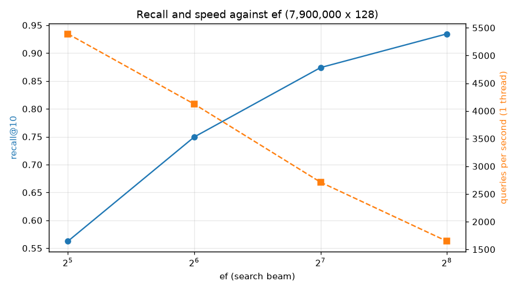
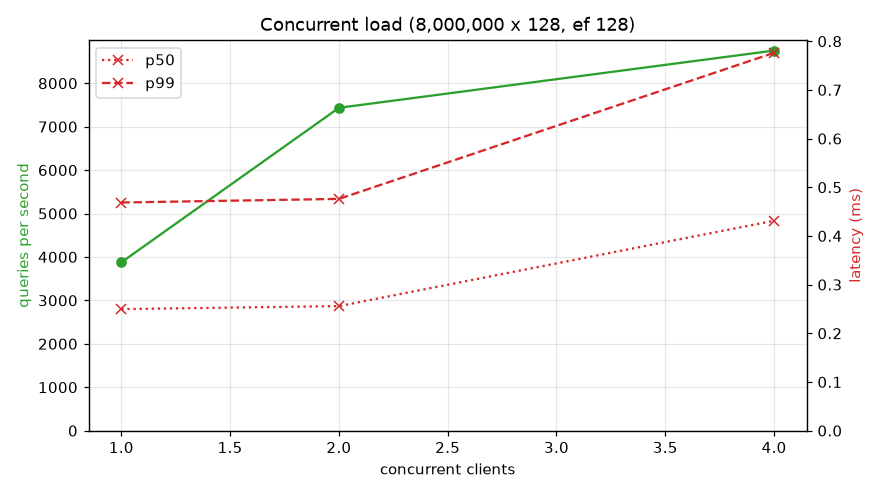
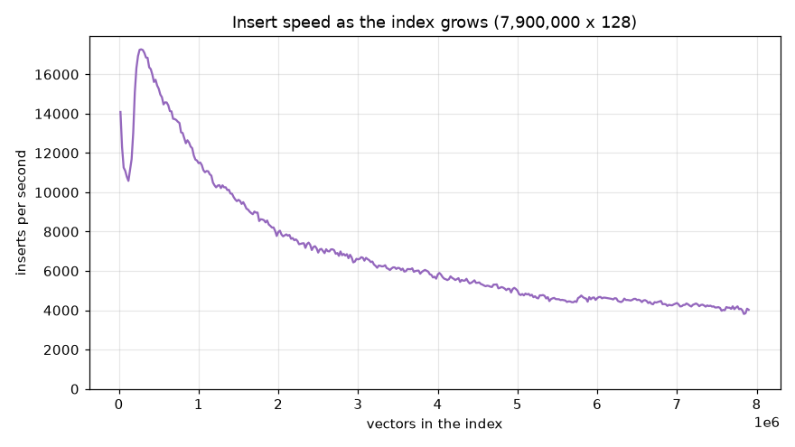
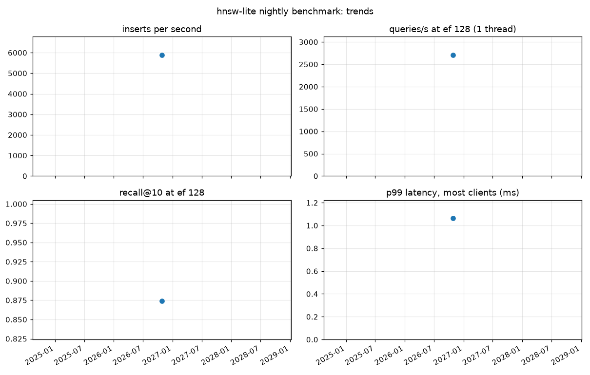

# hnsw-lite benchmarks

Published by the nightly workflow (`.github/workflows/benchmark.yml`) from `bench/python/stress.py`. Every run is kept in `runs/`; this page shows the newest and the trends.

Comparisons on real datasets (SIFT1M, GloVe) against hnswlib, FAISS and USearch: [real-datasets](real-datasets/README.md).

## Latest: 2026-10-28 08:11 UTC, commit [`9f53b0b`](https://github.com/praknig/hnsw_lite/commit/9f53b0b580416f6ff9d80094d7c48e13f78fa8a0)

**8,000,000 vectors of 128 dimensions**, M 16, ef_construction 200; 4 cores; Python 3.12.15. **16 of 17 checks passed** ([run](https://github.com/praknig/hnsw_lite/actions/runs/40651868966)).

## Trends

Runs on different machines or of different sizes are not directly comparable (sizes are marked on the chart when they vary).

| Date (UTC) | Commit | Vectors | Inserts/s | Recall@10 (ef 128) | Queries/s (ef 128) | p99 ms | Checks |
|---|---|---|---|---|---|---|---|
| 2026-10-28 08:11 | `9f53b0b` | 8,000,000 | 6,106 | 0.874 | 2,778 | 1.06 | 16/17 **FAIL** |
| 2026-10-27 07:29 | `1fc4117` | 8,000,000 | 6,060 | 0.869 | 3,249 | 0.78 | 16/17 **FAIL** |
| 2026-10-26 11:39 | `1fc4117` | 7,900,000 | 5,881 | 0.874 | 2,865 | 1.05 | 16/17 **FAIL** |
| 2026-10-26 07:41 | `320d6e5` | 7,900,000 | 5,898 | 0.874 | 2,713 | 1.06 | 16/17 **FAIL** |

## Failed checks in the latest run

- recall@10 at ef 128 is at least 0.9: 0.874
