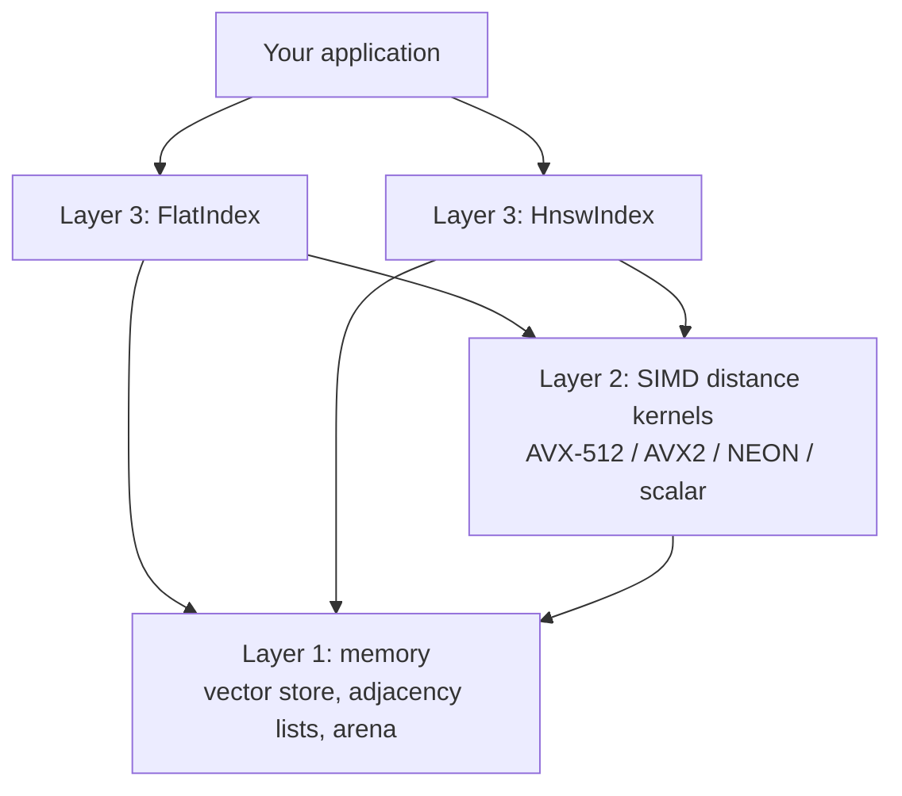
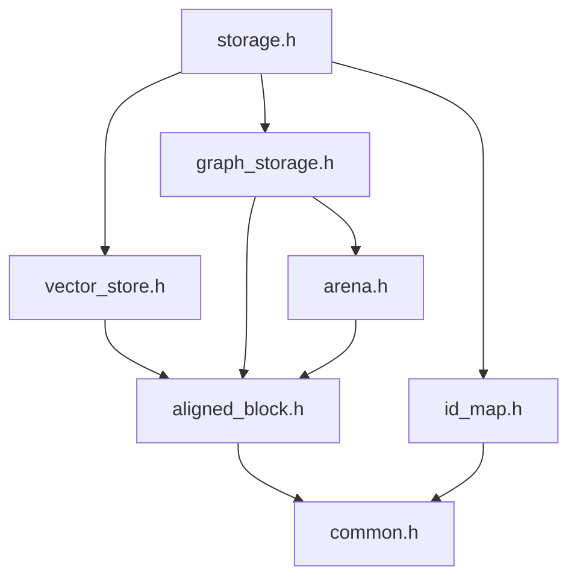
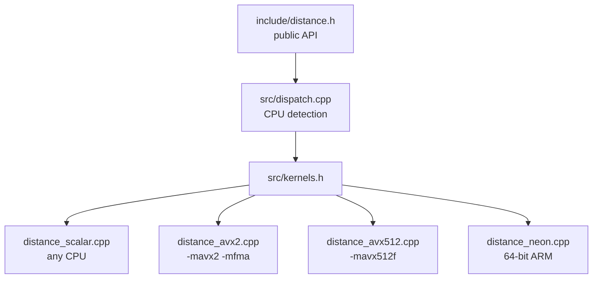
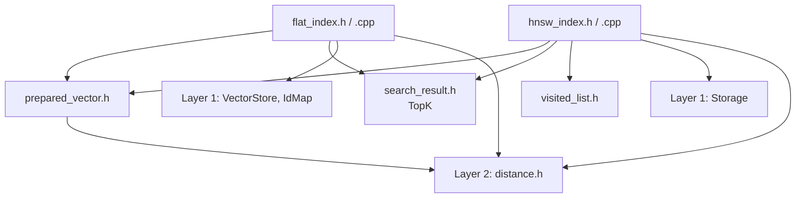

# Architecture and design

How hnsw-lite works inside: the three layers, the files, the memory layout, the SIMD distance kernels, the Flat and HNSW indexes, and the search features (metadata, filters, the query planner, batch and range search). To use the library, see the [User guide](user-guide.md) instead.

## Architecture

The engine is built as three layers. Each layer only depends on the ones below it.



| Layer | Purpose | Status |
|---|---|---|
| 1. Memory | Stores vectors and neighbor lists; finds them by arithmetic | Done |
| 2. Distance kernels | Measures how close two vectors are, using SIMD | Done |
| 3. Indexes | Flat (exact) and HNSW (approximate) search | Done |

### Layer 1 file dependencies



### Layer 2 file dependencies



### Layer 3 file dependencies



## Project structure

```
hnsw-lite/
├── .github/
│   └── workflows/
│       └── ci.yml              # GitHub Actions: build and test on every PR
├── .gitignore                  # Ignores IDE settings and build output
├── LICENSE                     # MIT License
├── CMakeLists.txt              # Builds the library, tests, benchmarks and examples
├── README.md                   # Start here: what it is and how to use it
├── docs/
│   ├── getting-started.md      # Building, build options, using it in your project
│   ├── user-guide.md           # How to use every feature
│   ├── api-reference.md        # Every public class and function
│   ├── performance.md          # Benchmarks and tuning
│   ├── architecture.md         # This file: how it works inside
│   ├── testing.md              # Tests, coverage, CI, bugs found
│   ├── project-notes.md        # Limitations, roadmap, comparison, references
│   ├── core-capabilities-plan.md       # Plan: deletion, update, persistence, concurrency
│   └── core-capabilities-test-plan.md  # Test scenarios for that plan
├── examples/                   # Small, complete programs
│   ├── example_basics.cpp      # Add, search, update, remove, compact
│   ├── example_filters.cpp     # Metadata, filters, predicates
│   └── example_batch_range.cpp # Batch and range search
├── include/                    # Public headers (namespace vecdb)
│   ├── common.h                # Layer 1: NodeId, kEmpty, kAlign, round_up
│   ├── aligned_block.h         # Layer 1: AlignedBlock, one aligned memory block
│   ├── arena.h                 # Layer 1: Arena, bump allocator
│   ├── vector_store.h          # Layer 1: VectorStore, aligned padded rows
│   ├── id_map.h                # Layer 1: IdMap, user ID <-> internal ID
│   ├── graph_storage.h         # Layer 1: GraphStorage, HNSW neighbor lists
│   ├── storage.h               # Layer 1: Storage, single entry point
│   ├── distance.h              # Layer 2: Metric, get_distance(), normalize()
│   ├── search_result.h         # Layer 3: SearchResult, Candidate, TopK
│   ├── prepared_vector.h       # Layer 3: PreparedVector, padded/normalized input
│   ├── visited_list.h          # Layer 3: VisitedList, VisitedListPool
│   ├── flat_index.h            # Layer 3: FlatIndex
│   ├── hnsw_index.h            # Layer 3: HnswIndex, HnswParams
│   ├── serialize.h             # Saving: checksums, writer, untrusted-file reader, FormatError
│   ├── kmeans.h                # k-means training (for PQ and IVF)
│   ├── codec.h                 # Vector codecs: SQ8, binary, PQ
│   ├── vamana.h                # The Vamana graph (DiskANN)
│   ├── disk_index.h            # The disk-based index
│   ├── health.h                # Health reports
│   ├── change_log.h            # An index's write-ahead log hook
│   ├── wal.h                   # Write-ahead log segments
│   ├── wal_ops.h               # Logged operations and their encoding
│   ├── durable.h               # Durable directories
│   ├── sparse.h                # Sparse vectors, BM25, hybrid search
│   ├── collection.h            # Documents over dense, text and sparse sides
│   ├── metadata.h              # Search: Value, Metadata, Schema, MetadataStore
│   ├── filter.h                # Search: Filter, CompiledFilter, SearchOptions, planner interface
│   ├── payload_index.h         # Search: ValueCounts (exact value counts)
│   └── thread_pool.h           # Search: ThreadPool, SharedPool (batch search)
├── src/                        # Compiled code (Layers 2 and 3)
│   ├── kernels.h               # Internal declarations of all kernels
│   ├── dispatch.cpp            # CPU detection, kernel selection, normalize()
│   ├── distance_scalar.cpp     # Plain loops, any CPU (reference version)
│   ├── distance_avx2.cpp       # AVX2 + FMA, 8 floats per instruction
│   ├── distance_avx512.cpp     # AVX-512F, 16 floats per instruction
│   ├── distance_neon.cpp       # NEON, 4 floats per instruction (ARM only)
│   ├── flat_index.cpp          # FlatIndex implementation
│   ├── hnsw_index.cpp          # HnswIndex implementation
│   ├── persistence.cpp         # Saving and loading (file format version 3; reads 1 to 3)
│   ├── kmeans.cpp              # k-means (built without floating-point contraction)
│   ├── codec.cpp               # Codecs (built without floating-point contraction)
│   ├── vamana.cpp              # Building and searching Vamana graphs
│   ├── disk_index.cpp          # The disk index: file layout, reads, search
│   ├── health.cpp              # Health reports for every index type
│   ├── upkeep.cpp              # Incremental upkeep (consolidation, reconnection)
│   ├── rebuild.cpp             # Rebuilding while in use, with an atomic swap
│   ├── wal.cpp                 # Log segments: writing, syncing, reading
│   ├── wal_ops.cpp             # Encoding logged operations
│   ├── wal_replay.cpp          # Logging hooks and replay
│   ├── durable.cpp             # Durable directories: create, recover, checkpoint
│   ├── sparse.cpp              # Sparse index, BM25, fusion
│   ├── collection.cpp          # Collections
│   └── query_planner.cpp       # Compiled filters and the query planner
├── tests/
│   ├── data/                   # Golden files: format version 1, for compatibility tests
│   └── test_comprehensive.cpp  # All 893 tests with a built-in runner
└── bench/
    ├── bench_distance.cpp      # Speed of every kernel version
    ├── bench_search.cpp        # Flat vs. HNSW: queries/s and recall
    ├── bench_baseline.cpp      # Fixed-seed baseline, or a real dataset (.fvecs)
    ├── bench_codecs.cpp        # Code kernels: SQ8, binary, PQ
    └── bench_durability.cpp    # Additions per second in each durability mode
```

Layer 1 and the Layer 3 helpers are header-only. Layer 2's kernels and Layer 3's indexes are compiled into a static library (`hnsw_lite`); the SIMD files need their own compiler flags, and the indexes contain real logic.

## Layer 1 design: memory and storage

### Goals

Every design choice in Layer 1 follows three rules:

1. **Find anything by arithmetic.** Converting a vector's number to its memory address is a calculation, never a search.
2. **Never move data.** Once something is stored, its address stays the same, so views (`std::span`) and pointers stay valid.
3. **Match the hardware.** The processor reads memory in 64-byte cache lines, so data is aligned to and packed into whole cache lines.

### Internal IDs

Users identify vectors with their own 64-bit IDs. Internally, each vector gets a dense `NodeId` (a 32-bit unsigned integer) in insertion order: 0, 1, 2, and so on. The same `NodeId` is used as an index into every array: vector rows, neighbor lists, levels and deletion flags. 32-bit IDs also halve the size of neighbor lists compared to 64-bit IDs or pointers.

### Alignment and padding

Each vector row is padded with zeros to a multiple of 16 floats (64 bytes):

| Dimension | Stored size (stride) | Padding |
|---|---|---|
| 100 | 112 floats | 12 zeros |
| 128 | 128 floats | none |
| 384 | 384 floats | none |
| 768 | 768 floats | none |
| 1536 | 1536 floats | none |

Because every memory block starts on a 64-byte boundary and every row is a whole number of cache lines, every row starts on a cache-line boundary. This avoids loads that span two cache lines, and lets the SIMD kernels process whole rows with no leftover elements. Padding is always zero, so it never changes distance results.

### Chunked storage

Rows are stored in fixed-size blocks of `2^shelf_bits` rows. By default a block holds up to 65,536 rows but at most 8 MB (for example, 16,384 rows at 128 dimensions and 1,024 rows at 1,536 dimensions), so small indexes of long vectors stay small. New blocks are added when needed; existing blocks never move or grow. **Blocks are not filled when allocated:** each row is written when its vector is added (the vector, then zeros in the padding the SIMD kernels read), and large blocks come from the operating system as pages that become resident only when first written, so the unused part of a block costs address space but no memory. (Filling them cost an index of 100 vectors 17.5 MB resident; it now takes about 1.6 MB. Where transparent huge pages are set to `always`, each block's first write brings in a 2 MB page, so a small index holds about 2 MB per block it has written to.) Finding vector `N`:

```
block   = N >> shelf_bits
row     = N & (2^shelf_bits - 1)
address = block_start + row * stride
```

Neighbor lists on level 0 use the same scheme.

### Arena allocator

Variable-size data (upper-level neighbor lists) comes from a bump allocator. It requests large blocks (1 MB by default) and hands out pieces by advancing a counter. Individual pieces are never freed; everything is freed when the arena is destroyed. This avoids one heap allocation per node and keeps related data close together in memory. Only trivially copyable, trivially destructible types may be stored, which is checked at compile time.

### Graph storage

- **Level 0:** every node has `M0 = 2 * M` slots. With `M = 16`, that is 32 slots × 4 bytes = 128 bytes, exactly two cache lines.
- **Levels 1 and up:** a node at level `L` gets one arena allocation of `L * M` slots. Only about `1 / M` of nodes reach level 1, so most nodes use no extra memory.
- **Empty slots** hold `kEmpty` (the maximum `NodeId`). A list's length is the position of the first `kEmpty`. Level-0 blocks are left untouched when allocated; each node's slots are set to `kEmpty` when the node is added, so unused rows of a block never become resident.

### Memory budget

Approximate memory for 1 million vectors with 768 dimensions and `M = 16`:

| Component | Memory |
|---|---|
| Vectors (768 floats × 4 bytes) | ~3.07 GB |
| Level-0 neighbor lists (128 bytes each) | ~128 MB |
| Upper-level neighbor lists | ~4 MB |
| Levels, deletion flags, ID list | ~10 MB |
| User ID hash map | tens of MB |

The graph is about 4% of the vector data, so it can afford fixed-size slots in exchange for speed.

## Layer 2 design: distance kernels

A single HNSW search computes thousands of distances, and a Flat search computes one per stored vector. Nearly all search time is spent in these kernels.

### Metrics

Every distance follows one rule: **a smaller value means closer**. This keeps the search code independent of the metric.

| Metric | Returns | Notes |
|---|---|---|
| `L2` | Σ (aᵢ − bᵢ)² | No square root: the ranking is the same and it saves work |
| `InnerProduct` | −(a · b) | Negated so that a larger dot product gives a smaller distance |
| `Cosine` | 1 − (a · b) | Vectors must be normalized first with `normalize()` |

Cosine normally needs both vectors' lengths on every call. Instead, vectors are scaled to length 1 once, before they are stored, which turns cosine into a plain dot product. Only two real kernels (L2 and dot product) are therefore needed per instruction set.

### SIMD versions

| Version | Floats per instruction | Main loop | Available on |
|---|---|---|---|
| Scalar | 1 | 1 per step | Every CPU |
| NEON | 4 | 16 per step | 64-bit ARM |
| AVX2 + FMA | 8 | 32 per step | Most x86 CPUs since about 2013 |
| AVX-512F | 16 | 64 per step | Newer Intel server CPUs, AMD Zen 4 and later |

Each SIMD kernel works in three stages:

1. **Main loop** with **4 independent running sums**. A single running sum forces every addition to wait for the previous one; four sums let the CPU work on four additions at once. FMA (fused multiply-add) does each multiply and add in one instruction.
2. **Leftover loop**, one register at a time, for lengths that are not a multiple of the main-loop size.
3. **Final reduction**: the running sums are combined and the values inside the register are added into one number.

Because Layer 1 pads every row to a multiple of 16 floats, no kernel ever needs a scalar tail loop. Kernels use unaligned load instructions, which are as fast as aligned loads on aligned data and never crash on unaligned input.

### Runtime dispatch

All versions are built into one binary, and the fastest usable one is chosen when the program first asks for a kernel:

1. **Compile time:** CMake adds the AVX2 and AVX-512 files only on x86-64, each compiled with only its own flags, and defines `HNSW_LITE_HAVE_AVX2` / `HNSW_LITE_HAVE_AVX512`. On 64-bit ARM it defines `HNSW_LITE_HAVE_NEON`. The NEON file is part of every build but compiles to nothing on x86.
2. **Run time (x86):** `cpuid` reports which instruction sets the CPU supports, and `xgetbv` reports whether the operating system saves the wide registers. Both must agree: a CPU can support AVX-512 while the OS has it disabled.
3. **Choice:** AVX-512, then AVX2, then NEON, then scalar. The result is cached in function-local statics, which C++ initializes exactly once, even with several threads.

### Safety rule for SIMD files

`src/kernels.h` contains declarations only, and kernel files include as little as possible. If a file compiled with `-mavx2` included a header with inline functions, the compiler could build those functions with AVX2 instructions, and the linker could then use that copy everywhere, crashing on CPUs without AVX2.

### Input rules

Every `DistanceFn` expects:

- `n` to be a multiple of 16 (pass `VectorStore::stride()`, not `dim()`);
- values beyond the real dimension to be zero (`VectorStore` guarantees this).

Vectors from users are not padded, so Layer 3's `PreparedVector` copies each query (and each new vector) into a padded, aligned buffer first.

## Layer 3 design: indexes

Layer 3 decides **which** vectors to compare and in what order. It never manages memory (Layer 1) or computes distances itself (Layer 2).

### Components

| Component | Responsibility | Uses from Layer 1 | Uses from Layer 2 |
|---|---|---|---|
| `PreparedVector` | Copies a user vector into a padded, aligned buffer; normalizes it for cosine | `AlignedBlock`, `round_up` | `normalize`, `Metric` |
| `TopK`, `Candidate`, `SearchResult` | Keeps the k best candidates in a bounded max-heap | `NodeId` | none |
| `VisitedList`, `VisitedListPool` | Marks visited nodes in O(1); reuses lists across searches | `NodeId` | none |
| `FlatIndex` | Exact search over every vector | `VectorStore`, `IdMap` | `get_distance`, `DistanceFn` |
| `HnswIndex` | Approximate search over a multi-level graph | `Storage` (all three parts), `kEmpty` | `get_distance`, `DistanceFn` |

`FlatIndex` uses `VectorStore` and `IdMap` directly instead of `Storage`, so it does not pay for 128 bytes of unused neighbor slots per vector. `HnswIndex` uses `Storage`, whose `insert(id, vector, level)` keeps a vector, its neighbor lists and its user ID under the same number.

Only one change was needed in the lower layers: `GraphStorage::set_links`, which replaces a node's neighbor list and clears the leftover slots.

### Shared rules

- **Internal numbers inside, user IDs at the edges.** Every loop works with `NodeId`s, which index Layer 1's arrays directly. User IDs are translated only when an add or remove arrives and when results are returned.
- **Kernel chosen once.** Each index stores its `DistanceFn` when it is created, so search loops make direct calls.
- **One preparation path.** Inserts and queries both go through `PreparedVector`, so cosine normalization cannot be forgotten in one of them.
- **Real deletion.** Flat moves its last vector into the removed vector's slot (swap-with-last). HNSW optionally repairs the removed vector's neighbors, frees its ID, and puts its slot on a free list that the next insert reuses (last in, first out). Removing the entry point picks a new live one; removing everything leaves the entry point `kEmpty`, as in a new index. Links left pointing at a reused slot from a level the node no longer reaches ("stale" links) are skipped by searches and dropped by inserts and repairs.
- **Errors leave the index unchanged.** A wrong dimension, a NaN or infinite value, or a duplicate ID throws `std::invalid_argument` before anything is modified (and, in HNSW, before a random level is drawn, so later inserts build exactly the same graph). A removed ID can be added again.
- **Only finite values.** `PreparedVector` rejects NaN and infinity, because one such value would corrupt every distance computed against that vector. Layer 1 itself stores any float.
- **Inserts survive running out of memory.** `IdMap`, `VectorStore`, `GraphStorage`, `Storage` and `FlatIndex` inserts are all-or-nothing: they grow their containers before changing anything, and `Storage` undoes earlier steps if a later one fails. An HNSW insert that fails while linking marks its half-linked vector as removed, so the index stays consistent; that vector's ID stays taken.
- **NaN distances sort last.** Inputs are finite, but an inner product of huge values can still overflow to NaN; `ordered_distance` turns it into +∞.
- **Oversized requests are capped.** A `k` larger than the index returns everything; HNSW's `ef` is raised to at least `k` and capped at the number of nodes.

### FlatIndex

- **add:** prepare the vector, register the ID in `IdMap`, store the values in `VectorStore`.
- **search:** prepare the query; for every vector, skip it if removed, otherwise compute the distance and offer it to a `TopK` of size k; return the sorted results with user IDs.

Cost: one distance per stored vector. Exact, with equal distances ordered by insertion.

### HnswIndex

**Structure.** Every vector is a node on level 0 with up to `2M` links. A node's top level is drawn at random as `floor(-ln(u) / ln(M))`, so about 1 in M nodes reach level 1, 1 in M² reach level 2, and so on. The entry point is a node on the highest level. The random numbers are converted to doubles by hand rather than with `std::uniform_real_distribution`, so graphs are identical across compilers.

**Search** (`search(query, k, ef)`):

1. Prepare the query. Raise `ef` to at least `k`.
2. **Greedy descent:** from the entry point, on each level from the top down to 1, keep moving to any neighbor that is closer to the query.
3. **Beam search on level 0:** a min-heap of candidates to expand and a `TopK` of the best `ef` results. Repeatedly expand the closest candidate; stop when it is farther than the worst result. A borrowed `VisitedList` prevents checking a node twice.
4. Return the best k, skipping removed nodes, with user IDs.

**Insert** (`add(id, vector)`):

1. Validate and prepare the vector; reject duplicates before drawing a random level.
2. Draw the level and store everything with `Storage::insert`. The first node becomes the entry point.
3. Greedy descent from the entry point down to the level just above the new node's level.
4. On each level from the new node's level (or the current top, if lower) down to 0: beam search with `ef_construction`, choose up to M neighbors with the heuristic, and link both ways. The best nodes found become the starting points for the next level. Removed nodes are traveled through but not chosen as neighbors, so new nodes do not waste link slots on them; only if every nearby node is removed does the new node link to them, so it can never end up unreachable.
5. If the new node is higher than every other node, it becomes the entry point.

**Neighbor heuristic.** Candidates are considered closest first; one is kept only if it is closer to the base node than to every neighbor already kept. This keeps links pointing in different directions instead of into one cluster, which keeps the graph navigable. When a neighbor's list is full, the heuristic re-selects that list from its old links plus the new node. These choices match hnswlib.

One addition beyond hnswlib: a candidate that is a **bit-identical copy** of an already-kept neighbor is skipped. Identical vectors are all at distance 0 from each other, a tie, so the plain rule keeps every copy, and lists near a cluster of duplicates fill up with copies of one point. In testing with 200 identical vectors among 200 random ones, this cut links to the rest of the graph and made 44 of the random vectors unreachable; with the copy check, every random vector stays reachable. The check uses `memcmp`, which stops at the first differing byte, so it costs almost nothing, and on data without duplicates the graph is unchanged.

**Threading.** Each search borrows its own `VisitedList` from a mutex-protected pool and returns it automatically through an RAII handle, so any number of searches run at once. How searches and changes share an index is described in [Thread safety](#thread-safety).

### Updating vectors

`FlatIndex::update` validates the new vector, then overwrites the row in place: nothing can fail after validation.

`HnswIndex::update` must never lose the old vector, even if memory runs out. Removing the old version and re-inserting cannot promise that (a failure during the re-insert would leave neither), so the order is reversed:

1. **Build the new version in another slot** (a free slot, or a new one at the end). The slot holds the user ID but is not yet findable (`IdMap::add_unmapped`, `occupy_unmapped`), and its metadata is written there.
2. **Link it** like any insert, except that the old version is never chosen as a neighbor (`Eligibility::exclude`), since it is about to go. One exception: if the old version is the only live vector the search can reach (possible in sparse graphs after many removals without repair), the new version links through it rather than to nothing; once retired, the old version stays traversable and bridges to the new one.
3. **Repair the graph around the old version** (if `repair_on_remove`), while it is still live, exactly as `remove()` does.
4. **Commit**, with nothing that can fail: the ID is pointed at the new slot (`repoint`), the old slot is retired and its metadata cleared, it joins the free list, and a new entry point is chosen if the old version was the entry point.

A failure in steps 1 to 3 abandons the new version like a failed insert, restoring the entry point; the old vector is untouched. The price is one extra slot during the switch: the first update grows capacity by one, and that slot is then reused by every later update or insert, so capacity never exceeds the peak number of live vectors plus one.

### Saving and loading

**File format (version 3; versions 1 and 2 are still read).** All numbers are little-endian. A 24-byte header (the magic text `HNSWLITE`, the format version, a byte-order mark, the index kind and a reserved field) is followed by sections, each a 4-letter tag, a 64-bit length, the payload and a CRC-32 of the payload, and finally an empty `END ` section; nothing may follow it.

| Section | Flat | HNSW |
|---|---|---|
| `CONF` | Dimension, metric; version 3: truncation, keep-full-vectors and vector-values flags | Dimension, metric, `M`, `ef_construction`, seed, graph repair, planner settings; version 3: the same three |
| `NODE` | Each vector with its user ID; the vector as given when kept (cosine since version 2, truncation in version 3); no vector values with codes only (version 3) | Each slot, live or removed: user ID, removed flag, level, vector (none with codes only), the vector as given when kept, then the links on each level |
| `CODC` (version 3) | Quantization settings; when trained, the codec's state and every slot's code; the number of PQ parts last | The same |
| `IVFL` (version 3) | Inverted-file settings; when trained, the centroids and each row's list | |
| `STAT` | | Entry point, top level, free slots in reuse order, the random generator's state |
| `META` | Metadata | Metadata: schema mode, fields (name, type, indexed), string dictionary, then each field's rows in slot order |

**Design choices:**
- **The graph is saved logically** (levels and link lists) and rebuilt on load, so files do not depend on memory addresses. The arena's raw pointers are never written.
- **Removed slots are saved:** other vectors may still link through them, and inserts reuse them in a fixed order. With the free list and the random generator's state, a loaded index continues exactly as the original would have. The generator is SplitMix64, whose whole state is one 64-bit number saved as plain bytes. (An earlier draft saved `std::mt19937_64` through C++ streams; its text form turned out to differ between libstdc++ and libc++, which the golden files caught on macOS before release.)
- **Derived data is recomputed, not trusted:** payload-index counts and string reference counts are rebuilt from the rows on load.
- **Each section's length is computed by a counting pass** before it is written, so saving needs no extra copy of the data.
- **Every save writes its own temporary file** (`<path>.tmp-<counter>-<mix>`: a per-process counter, mixed with the thread, the time and a memory address to separate processes), then renames it over the target. Saves run in parallel, and with one shared temporary name two saves to the same path overwrote each other mid-write.
- **Streams rethrow their errors** (`StreamErrorsThrow`): by default a C++ stream that runs out of memory only sets a flag and stops writing, which would produce a damaged file without an error.

**Loading untrusted files.** `persist::Reader` knows the file's size before reading (hence seekable streams), and checks every read against the bytes left in the section and the file. Every count is checked against those bytes **before** allocating, so a damaged count cannot trigger a huge allocation. After the checksums, the content is validated: link targets, self-links, repeated links, list lengths, levels, removed flags, finite vector values, unique user IDs, an entry point that is live and on the top level, a free list naming exactly the removed slots, the generator state, and every metadata value. Any problem throws `FormatError`, and nothing partly built escapes.

**Versions.** Version 2 added each cosine vector as given, before normalization, so `get_vector` returns it exactly (`Storage` keeps these originals slot by slot, through every insert, reuse, update, removal and compaction; `compact` rebuilds from them). Version 1 files still load: for a cosine index, the stored normalized vector stands in for the original. For L2 and inner-product indexes the two versions differ only in the version number.

**Compatibility** is guarded by small golden files in `tests/data/`: the version 1 files are frozen, proving that old files keep loading, and the version 2 files must be reproduced byte for byte. Their vectors are small whole numbers, which every distance kernel sums exactly, so every CI platform must rebuild the current version's files **byte for byte**; this checks the format, the determinism of saving and portability across platforms at once. `test_comprehensive --write-golden` writes the current version's files, for a deliberate format change only; older versions' files are never rewritten.

### Thread safety

Each index holds an `IndexLock`: searches, saves and lookups take it shared, changes take it alone. Public changes lock once and call unlocked internals (`add_unlocked`, `replace`), so `upsert` (look up, then update or insert) is atomic, and `compact` fills its fresh index without locking it, since no other thread can see it.

**Why not `std::shared_mutex`?** With glibc it prefers readers, so a change could wait forever behind overlapping searches. `IndexLock` prefers writers: while a change is queued, new top-level searches wait.

**Nesting and deadlock freedom.** Predicates may search indexes, including the one being filtered, and batch tasks run on pool threads on behalf of a caller that already holds the lock. Each thread therefore records which indexes it is inside (a small fixed array, no allocation; nesting deeper than 64 throws `std::logic_error`), and two rules apply:

1. **No change from inside any index operation.** It throws `std::logic_error`. A change nested in a read is what creates lock cycles: thread 1 inside a search of A changes B while thread 2 inside a search of B searches A.
2. **Nested reads skip the writer queue.** A search started from inside an index operation waits only for a change that is running, not for queued ones. A read of the same index does not lock again at all, and batch tasks inherit their caller's read (`IndexLock::Hold`).

Together these make a cycle impossible: a thread holding a lock waits only for a running change, and a running change, which by rule 1 holds no other lock and starts no nested operation, always finishes. An early version without rule 2 deadlocked in exactly the crossed-predicate pattern; test `c18` now checks it under a watchdog.

### Parallel building (`add_batch`)

The whole batch runs inside one change, holding the index lock alone, so searches never see a half-built batch, and the lowest storage layer needs no redesign for concurrent readers. Inside, it works in phases:

1. **Validate everything:** vectors, IDs against the index and within the batch, metadata (`MetadataStore::validate_batch` also requires a new dynamic field to have one type throughout). Nothing has changed yet.
2. **Reserve everything a rollback needs** (the free list, undo records), so undoing cannot fail.
3. **Vectors that reuse removed slots are inserted and linked one at a time**, exactly as `add` does. A reused slot keeps its old links (other nodes route through it) until the moment it is reused, so preparing it in advance would change the graph.
4. **The rest are stored, unlinked, in order:** vectors, metadata, empty link lists, levels drawn in order. All storage grows here, so nothing reallocates while threads link.
5. **Linking, on a thread pool.** Each node's link lists are guarded by one of 65,536 striped mutexes (`LinkLocks`, as in hnswlib); a thread holds one list lock at a time, so threads cannot deadlock. Searches read each list as a copy taken under its lock. A node that raises the top level holds the entry-point lock while it links, so two such nodes cannot each build an upper level the other cannot reach.

**Publish when complete.** A node first searches every level and decides all its neighbors without changing anything, then sets its own lists, and only then adds the reverse links that make it reachable. Until then no other thread can reach it, so none descends into a level it has not linked yet, and none adds a link that its own list would later overwrite. (An earlier version linked level by level; under ThreadSanitizer's interleaving, other threads reached half-linked nodes and graph quality dropped.) Deferring changes nothing else, since each level's search starts from the previous level's results, never from links the node created; one thread therefore gives exactly the same graph as `add` in order.

**Rollback.** If anything fails after step 2, every node the batch stored is removed (newest first, undoing metadata exactly), which cannot fail; then the graph is repaired around them as `remove` does, best effort. All batch nodes are already removed then, so no repair links to one of them.

### Deadlines, cancellation and progress

**Searches** do not pass a deadline through every internal function. The public search installs a `detail::SearchStopScope` for its duration: a thread-local pointer to the search's deadline and cancel flag, restoring the previous one afterwards, so a search inside a predicate has its own. The inner loops (graph search, exact scans, range searches, Flat's tiles) call `detail::search_should_stop()` every 32 graph steps or 256 rows; with no deadline it costs one thread-local read. On stopping, a loop simply ends, so the results are the best found so far. When the scope ends, after the search has written its statistics, it sets `SearchStats::stopped_early`. Batch searches install one scope per worker task. Inserts use the same search code but never install a scope, so they are unaffected.

**Long operations** use `detail::OperationControl`: it checks the cancel flag and deadline, throwing `Cancelled`, and reports progress under a mutex (monotonic, about once per percent). Each operation is built so that a throw at any check undoes it: `add_batch` rolls back, `compact` discards the replacement it was building, and a save to a path removes its temporary file. The final progress report happens before the work becomes permanent (inside `add_batch`'s rollback scope, before `compact`'s commit, before a save's rename), so a callback that throws then still undoes the operation.

### Training and codecs

**k-means** (`kmeans.h`) trains centroids for product quantization and the IVF index: k-means++ seeding (each new centroid drawn with probability proportional to its squared distance from the nearest so far), then Lloyd's refinement until no assignment changes. A cluster that becomes empty takes the point farthest from its own centroid. Points are assigned in fixed-size chunks, possibly on several threads; since each point's assignment is independent, the thread count never changes the result.

**Codecs** (`codec.h`) store vectors compactly. A codec is trained once, encodes each vector into `code_size()` bytes, and computes distances between a full-precision query and a code (asymmetric distance): `prepare()` turns the query into a small table once, then `distance()` compares the table with each code in a single pass. Distances follow the library's conventions (squared L2, negative dot product, 1 minus dot product), so they are directly comparable with full-precision ones. **SQ8** maps each dimension onto 256 even levels between its smallest and largest trained value: one byte per dimension, with a rounding error of at most half a level. Training, encoding and decoding compute in double, so values spanning more than the float range (where `max - min` would overflow a float) work too; ordinary codes are the same as with float arithmetic.

**Bit-identical everywhere.** Centroids and codes are saved in index files, and the golden-file tests require those files to be identical on every platform. So random choices use SplitMix64, sums are accumulated in a fixed order, and `kmeans.cpp` and `codec.cpp` are compiled without floating-point contraction (`-ffp-contract=off`): GCC fuses `a * b + c` into one instruction by default on ARM, which changes rounding. Built for ARM64 without the flag, SQ8 distances differed from x86; with it, every result matches bit for bit.

### Compressed indexes

**Maintenance** (`collection.cpp`). Counters of dense vectors replaced or removed since the last upkeep and rebuild (atomics, updated under the collection's exclusive lock), and the last snapshot's LSN and time, drive `maintain()`: a reachability-only health check, `upkeep()` with the round's deadline, a drift check with a retrained sample, `rebuild()`, then `checkpoint()`, one round at a time under a maintenance mutex, never holding the collection's lock while the sides work (they lock themselves). A background thread waits on a condition variable between rounds, records errors in the round's report, and is joined before any member is destroyed. Upkeep stops at a deadline only after one repair in the call, so budgeted rounds always progress; a checkpoint whose snapshot failed retries only the snapshot (the log already writes to the new segment).

**Collections** (`collection.cpp`). A `Collection` owns up to three sides (an `HnswIndex` without metadata, and one `SparseIndex` each for BM25 text and learned sparse vectors), plus its own ID table (slots, a free list kept in order), texts and a `MetadataStore`. Filters compile against the collection's metadata and reach every side as a predicate. A change is validated, logged once (`kDocument`, `kDocumentRemove`, `kDocumentMetadata` records), then applied side by side under the collection's exclusive lock; the old parts are read first so that an out-of-memory failure on a later side restores the earlier ones. Searches hold the shared lock; a per-thread list of collections being searched lets predicates read without locking again and refuses changes (instead of deadlocking). Search fuses any number of ranked lists by RRF or min-max-scaled scores. Durable collections reuse the durable-directory code (kind 3) with one log; the snapshot embeds each side's own file. `SparseIndex` saves its compacted form, so saved bytes do not depend on removals awaiting compaction.

**Sparse vectors and hybrid search** (`sparse.cpp`). `SparseIndex` stores each document's sorted terms and weights per slot, a posting list (slots ascending, weights) per term, and exact document frequencies. A search accumulates `query weight x document weight` into per-thread score buffers (reset only where touched; a search nested in a predicate gets its own) over the query's posting lists, skipping removed slots, then keeps the k best after filters and predicates. Removal marks the slot dead and leaves its posting entries; once dead entries outnumber live ones, posting lists and slots are rebuilt aside and swapped in. Inserts reserve every allocation before the metadata write, so they are all-or-nothing under allocation failure. The file format reuses the checksummed sections (index kind 3). `Bm25` hashes tokens (FNV-1a) and splits BM25 into document and query weights; `fuse()` combines ranked lists by RRF or min-max-scaled scores.

**Durability** (`wal.cpp`, `wal_ops.cpp`, `wal_replay.cpp`, `durable.cpp`). A log segment is a checksummed header (magic, version, index identity, first LSN) and records (length, CRC-32, LSN, type, payload), written with positional writes; a failed append is cut back to the last complete record, and a writer that cannot cut back or sync refuses further work. Reading tells a torn tail (an incomplete record, an invalid record ending exactly at the end, or zero-filled space) from corruption (an invalid record followed by data, an LSN out of sequence). Every public change is logged under the write lock through `ChangeLog` (`change_log.h`, shared by both in-memory indexes), whose scope guard writes an abort record if the operation then throws; operations depending on state are logged as their effect (upsert as add or update, filtered removals and metadata changes as their IDs). Replay applies records through the public methods, skipping aborted ones; failed inserts restore the level generator, so replay reproduces the graph. A durable directory holds DURABLE (identity), numbered snapshots and segments, and LOCK; checkpoints rotate the segment and write the snapshot under the shared lock and a checkpoint mutex, then prune; recovery takes the newest readable snapshot, collects records across segments without gaps, accepts a torn tail only in the last segment, and drops a failing final operation (with a checkpoint). A background thread flushes in `Grouped` mode.

**Rebuilding** (`rebuild.cpp`). While a rebuild runs, every write path records the IDs it is about to change (`note_change`, before anything can fail; recording an unchanged ID is harmless, missing one would revive stale data). HNSW: phase 1 copies every record under the lock and samples stored vectors to train a codec on; phase 2, without any lock, builds a new index from the copy (a new codec trained first, or the old one cloned when only codes are kept); phase 3, under the lock, removes and re-adds each recorded ID through the new index's own unlocked paths (public calls from inside an index operation are refused), upkeeps the new graph if that removed anything, and moves the new state in. Flat: phase 1 copies the stored vectors; phase 2 trains the codec and k-means centroids on a sample and computes every copied vector's code and list; phase 3 matches current rows to the copy by ID (rows move when others are removed), recomputes the recorded ones, and swaps codec, codes, centroids, lists and positions together. Everything that can fail runs before the commit, and a failure stops the tracking.

**Neighbor selection.** `select_neighbors(base, candidates, max)` applies HNSW's diversity rule (skip a candidate that a kept neighbor is closer to, or that is a copy of one) to distinct candidates, choosing them first but only up to the list minus room for copies of the base itself (half the list, or all the copies if fewer); the copies, exempt from the rule, then fill whatever room remains. Equal distances are ordered by a hash of (base, candidate), with a full order so `std::sort` is deterministic and allocation-free (`stable_sort` falls back silently when its buffer cannot be allocated). Before, every copy was a copy of the first one kept, so a vector kept one link per group of copies, and ties went to the lowest node numbers: identical vectors were almost all unreachable.

**Upkeep** (`upkeep.cpp`). Under the lock alone: consolidation walks every live node and, on each level where it links to removed nodes, chooses its links again (with the usual diversity rule) from its live links and the removed nodes' live links; reconnection walks level 0 through live nodes only from the entry point and, for each unreachable vector, searches for it (descent plus `search_level`, which only visits reachable nodes) and links it from the nearest result with a free slot, or in place of a link whose target keeps another incoming link from a reachable node; repeated until all are reachable (at most 16 rounds). Removal repair (`repair_neighbors`) now also gives each of the removed node's former neighbors a link back from its nearest group member with a free slot, written in place without allocating, so an update that runs out of memory cannot leave its old version without incoming links. `compact()` is split into a locking wrapper and `compact_unlocked`, which removals and updates call when the automatic threshold is passed.

**Health reports** (`health.cpp`). Under the shared lock: one walk over the graph (degrees, incoming links, stale links and links to removed nodes on level 0) and a depth-first walk from the entry point that, like a search, may pass removed nodes; exact top-k answers for a sample of stored vectors, using the index's own distance function; and, on a second sample, the codec's reconstruction error (with a codec of the same kind retrained on a third, disjoint sample, since a codec flatters its training data) and the distance of vectors to their IVF centroids (and to centroids from a fresh k-means). The lock is then released and the sampled searches run through `search_by_id`, so the estimate is a snapshot. Removals and updates are counted where each change becomes final, so cancelled or rolled-back changes never count. `DiskIndex::health` reads every node once, in order, keeping the neighbor lists and finding the exact answers for its sample during the pass.

**Disk-based index.** `VamanaGraph` builds the DiskANN graph: a random graph of degree R, then two passes (alpha 1, then the given alpha) in which each node is searched for from the medoid and its neighbors replaced by the robust pruning of everything visited, with reverse edges. Three changes for degenerate data, each found by a test: with at most R + 1 vectors the complete graph is kept (pruning could only remove edges); a candidate identical to the node (distance 0) is never pruned, and equal distances are ordered by a hash of the node pair rather than by node number (otherwise identical vectors collapse onto a few hubs); and a connectivity repair at the end gives every node a path from the medoid (preferring free slots, then neighbors that keep another incoming edge), since Vamana does not guarantee it and an unreachable vector could never be found. `DiskIndex::build` writes block 0 (the header, with section offsets, sizes and checksums, and its own checksum), the node records (vector, degree, R neighbor slots; several per 4 KB block, or whole blocks each, never crossing a boundary), then the block checksums, PQ codebooks and codes, IDs and metadata, which `open` loads and verifies. A search ranks candidates by PQ distance (the codes are finer than PQ's default, one part per 2 dimensions, because they decide what is read), reads the W best unread per round through `BlockFile` (`pread`, or `ReadFile` with an offset), checks each block's checksum, and keeps the exact distances of every node read. A filter matching at most L vectors reads them directly; otherwise the candidate list is kept whole so that L can widen until k matching vectors are found. `build_from_file` streams a `.fbin` file through `BlockFile`: if it fits the budget it loads it and calls `build`; otherwise a sample gives partition centroids (k-means), the PQ codebooks and the medoid; one pass assigns each vector to its `replicas` nearest partitions that are not full and computes its PQ code; a Vamana graph is built per partition (vectors read in ascending order) and written in ID order; and one merge pass in ID order joins each vector's lists into an adjacency table and prunes those beyond R with distances from the PQ codes held in memory (equal distances ordered by a hash of the pair; no random reads); a connectivity repair then gives every unreachable vector an edge from a reachable vector it links to, as Vamana does in memory (counting only incoming edges from reachable vectors); and one sequential pass writes the final file through the same writer as `build`. The partition count is at least ceil(n * replicas / capacity) + replicas, which guarantees that every vector finds `replicas` partitions with room, so no partition exceeds the budget; automatically it also allows two thirds of slack. All temporary files go to one directory, removed whatever happens. Finished files are moved into place by `replace_file`: a plain rename on POSIX; on Windows a rename with POSIX semantics (so an index can be rebuilt while open, as on POSIX), falling back to `MoveFileEx`, then to moving the open file aside. With `io_threads`, an `IoPool` (a task queue shared by all searches, returning futures) reads each round's nodes concurrently; the search waits for all of them before passing on an error, then accounts for them in order on its own thread (predicates included), so results and statistics are identical to reading one after another. The pool is declared after the file, so destroying the index first finishes any queued read.

**Inverted file (IVF).** An option of `FlatIndex`: `train_lists` runs `kmeans` on the stored vectors (decoded, with codes only) and assigns every row to its nearest centroid, building everything in local variables and swapping it in at the end. Every row is in one list at a known position (`list_of_`, `pos_`), so each slot path is O(1): an add reserves room in its list before changing anything; a removal takes the row out of its list and, since Flat swaps the last row into the gap, renames the last row in its own list; an update that changes a vector's nearest list moves it; a batch rollback takes popped rows out. The scan orders the lists by centroid distance and visits at least `probes`, then more until `k` matching vectors were seen. Saved as `IVFL` (version 3): settings, centroids and each row's list; the lists and positions are rebuilt and checked on load.

**Product quantization** (`PQCodec`) splits a vector into parts (uneven sizes allowed: the first parts take the extra dimensions) and stores each as the index of its nearest centroid, one byte. Training runs `kmeans` on each part (256 centroids, fewer with fewer vectors); its state is the number of centroids followed by every part's centroids. The query table holds 256 entries per part (squared distance or negative dot product to each centroid), so a distance is one lookup per part. `nearest_centroid` breaks ties toward the lower index, so stored codes always name the lowest of duplicate centroids and decoding then encoding reproduces them. Loading checks that every code names an existing centroid; the number of parts is saved last in `CODC`, so earlier offsets did not move when it was added.

**Code kernels.** SQ8 and binary distances reduce to three kernels (`sq8_l2`, `sq8_dot`, `bits_sum`), with the same four versions as the float kernels (plain C++, AVX2, AVX-512, NEON), chosen once by the same CPU detection; each codec keeps the chosen set. SQ8 widens 8 or 16 code bytes to floats per step; binary spreads a code byte into a lane mask (AVX-512: two bytes are exactly its 16-lane mask). Encoding stays in `codec.cpp`, so codes and files do not depend on the CPU; only distances may differ in their last bits, as for float kernels.

**Binary codes** (`BinaryCodec`) store one bit per dimension: a value above its dimension's threshold (the training mean) sets the bit, which decodes to threshold plus or minus the dimension's spread (mean absolute deviation). The per-query table holds, for each dimension, the contribution of a 0 bit and the difference a 1 bit makes, so a distance is a sum over set bits. Encoding is a comparison, identical on every CPU. A set bit in a dimension constant in training (spread 0) decodes to the smallest float above the threshold, so decoding then encoding always reproduces a code (needed by `compact` with codes only).


An index with a codec keeps, besides its full-precision vectors, one code per slot in a plain byte array, `code_size()` bytes each. Codes follow every slot path: space for a code is reserved before anything else changes (so a failure leaves nothing behind), and the vector is encoded right after it is stored. Training builds a new codec and a complete new code array, then swaps both in, so it is all or nothing; compaction copies the trained codec into the rebuilt index, which encodes as it fills.

**Searching with codes** reuses the existing search code unchanged. Every distance in an HNSW search goes through `distance_to()`; while a search runs with codes, a per-thread `CodeQuery` (installed by `search_impl` for its duration, like the deadline scope) makes `distance_to()` compare the prepared query table with codes instead. Building the graph never installs it, so the graph is always built from full precision (decision D7). Range searches install an explicit full-precision marker, which also shadows the marker of a coded search they may be nested in (from its predicate). `k * rerank_factor` saturates instead of wrapping. Afterwards the candidates (the whole beam, or `k * rerank_factor` for exact scans) are re-scored at full precision and re-sorted. Flat compares codes in its scan, then re-ranks the same way; its batch search scans each query separately with codes, since its tiling is for full precision.

**Matryoshka truncation** separates an index's input dimension (`dim()`, the size of vectors and queries as given) from its indexed dimension (`indexed_dim()`, what `VectorStore`, the scratch vectors and the codec use). Every insert and query goes through `prepare_truncated`, which checks the whole input and prepares its first `indexed_dim()` values. The full vectors are kept as originals (`Storage` now allows originals of a larger dimension, and refuses an insert without one when they differ), so `get_vector` returns them, and `compact` rebuilds from them. A truncating index stores exactly what an ordinary index of the prefixes would, so the two give identical results.

**Keeping only the stored vectors.** With `keep_full_vectors = false`, `keeps_originals()` is false, so no originals are stored; `Storage::original()` then returns the stored vector, `compact` copies stored vectors into the rebuilt index exactly (through `add_unlocked(..., prepared = true)`: normalizing an already normalized vector again could change its last bits), and `as_input()` turns a stored vector back into an input for `search_by_id` (padded with zeros to `dim()` when truncating, values that truncation ignores). A file of version 2 or later holds originals exactly when the index keeps them.

**Keeping only codes.** With SQ8 and `keep_full_vectors = false`, training ends by dropping the float vectors: `VectorStore::drop_values()` frees them but keeps counting rows, so slot numbers, removal, reuse and swap-with-last work unchanged, and reading a value afterwards throws `std::logic_error` (a safety net for any missed read). Every read of a stored vector goes through `stored_padded` / `stored_copy` (the floats, or decoded from the code); `distance_to` decodes when no code table is installed, and `distance_between` first installs a full-precision marker so it never compares with an outer search's table; encoding uses the freshly prepared input; `same_vector` compares codes; re-ranking is off; `compact` rebuilds a codes-only index from decoded vectors, whose codes it reproduces exactly. Training again is refused: it could only learn from decoded vectors.

**File format version 3** adds the truncation setting, the keep-full-vectors flag and the vector-values flag at the end of `CONF` (with codes only, `NODE` records hold no vector values, and loading checks that `CODC` then holds a trained codec) (the vector records that follow need it to know their size) and a `CODC` section after the vectors: the quantization settings, a flag for whether the codec is trained, and if so the codec's state (for SQ8, each dimension's minimum and step) and every slot's code. Versions 1 and 2 load without a codec. A golden file with an SQ8-trained index (`golden_hnsw_sq8_v3.bin`) must be reproduced byte for byte on every platform, which checks that every CPU encodes identically.

## Search features design

### Metadata

Each vector can carry fields of five types: integer (`int64`), float (`double`, finite only), boolean, keyword (string) and tag set (strings). Metadata is attached with a small builder:

```cpp
index.add(id, vector, Metadata().set("category", "news").set("year", 2024)
                                .set("in_stock", true).set_tags("tags", {"ai", "chips"}));
```

**Schemas.** Each index chooses its schema mode:

| Mode | Unknown field at insert | Unknown field in a filter |
|---|---|---|
| `Schema::strict({...})` | Rejected | Error (catches typos) |
| `Schema::dynamic({...})` (default) | Created, with the type of its first value | Matches nothing (the field may not exist yet) |

In both modes a field keeps one type; a value of another type is rejected (an integer is accepted for a float field). Invalid metadata throws `std::invalid_argument` and changes nothing; a failed insert never leaves a newly created field behind.

**Storage.** `MetadataStore` keeps one column per field, indexed by slot like vectors and links: `int64`, `double`, a byte per boolean, a 4-byte dictionary ID per keyword, a list of dictionary IDs per tag set, plus a "has a value" byte. Strings are stored once in a dictionary, so keyword and tag comparisons are integer comparisons. Columns grow only to the highest slot written. Metadata follows its vector through every slot operation: Flat's swap-with-last moves the row, HNSW slot reuse overwrites it, removal clears it, `compact()` copies it. Writes are all-or-nothing: fields and strings are created and columns grown before anything visible changes.

### Filters

```cpp
Filter::eq("category", "news") && (Filter::ge("year", 2020) || Filter::has_tag("tags", "ai"))
```

Available conditions: `eq`, `ne`, `lt`, `le`, `gt`, `ge`, `between` (inclusive), `in`, `has_tag`, `has_any_tag`, `has_all_tags`, `exists`, combined with `&&`, `||` and `!`.

**Rules:**
- **Missing fields:** comparisons never match a vector without the field, including `ne` (as in SQL). `!` negates the whole condition, so `!Filter::eq("category", "news")` does match vectors without a category. `exists` tests presence.
- **Numbers:** integers and floats compare exactly with each other, even beyond the precision of a double.
- Keywords support `eq`, `ne`, `in`; booleans `eq`, `ne`, `in`; tag sets the `has_*` conditions. `between` with low above high, and an empty `in` list, match nothing. NaN values are rejected.

Filters are checked against each index's schema when used (type errors throw `std::invalid_argument`) and compiled to a flat form: field names become column numbers, strings become dictionary IDs. A compiled filter evaluates a slot with a few column reads and no memory allocation.

**Custom predicates.** `SearchOptions::predicate` accepts any `bool(user_id)` function, for conditions that live outside the index, such as permissions. Combined with a filter, both must pass, with the filter checked first. In batch search a predicate may be called from several threads at once, so it must be safe to call concurrently.

### Reordering for locality

`reorder()` renumbers the nodes of the existing graph without changing it. The order: breadth-first over level 0 from the entry point (unreachable live nodes after it), then grouped by each node's nearest of n/1,024 k-means centroids (trained on up to 10,000 sampled vectors, seed fixed, assignment on all cores), breadth-first within a group. A node's neighbors are near it in space, so mostly in its group, so near it in memory: on 4,000 clustered vectors the share of level-0 neighbors stored within 128 positions rose from 8% to 17%, within 1,024 from 52% to 69%. (Breadth-first order alone barely helps at this degree: its frontier grows about 2M-fold per step. An average gap misleads, being dominated by HNSW's deliberately long links.) The copy is built completely before the commit; codes are copied byte for byte. Small (under 1,024 vectors) and codes-only indexes keep the breadth-first order.

### Re-ranking, diversity, expiry and keys

**Re-ranking and MMR** (`scoring.h`, `scoring.cpp`) sit outside the search algorithms. A search given `modifiers` or `diversity` runs the plain search for a larger pool (`ScoreModifiers::pool_for(k)`, default max(4k, 20)), then re-scores it (each result's metadata read once; boost filters evaluated against a one-record store, so their rules are exactly a filtered search's) and/or re-orders it greedily by maximal marginal relevance over the stored vectors, and keeps k. Without them nothing changes. Base relevance from a distance: 1/(1+d) for L2, 1 − d/2 for cosine, the logistic of the dot product for inner product.

**Expiry and string keys** use two reserved metadata fields, `_expires_at` (an integer) and `_key` (a keyword), so they are logged, snapshotted and recovered like any metadata, and the file format is unchanged. Expiry is fixed when a document is written; searches and counts combine the caller's filter with `!lt(_expires_at, now)`, so an expired document disappears at once and is freed later. `replay()` sets a flag under which documents are applied exactly as logged (no reserved-name check, no new expiry time), so recovery neither rejects nor extends them. A string key's id is a 64-bit hash (FNV-1a with a SplitMix64 finish); the stored key is compared on every keyed operation, so two keys with the same hash are refused, never confused.

### Distances in the hot loops

A search computes thousands of distances, and each one has three possible paths: the full-precision vectors, the code table of a compressed search running on this thread, or decoding a codes-only index. Which path applies cannot change while a searching function runs, so it is decided once, at the start of each (`greedy_closest`, `search_level`, `acorn_level0`, `exact_scan`, `search_range`), in a `NodeDistance`: a few pointers and one predictable branch. The inner loop then goes straight to the row (`VectorStore::row_unchecked`: ids come from the graph and are always stored, and whether values are stored was part of the decision). Deciding per distance had cost two thread-local reads (inside a shared library such as the Python module, calls to `__tls_get_addr`), two out-of-line calls and a checked row lookup: about 10% of native search time, and 15% more from Python.

### The query planner

A filtered HNSW search can either scan the matching vectors exactly, or search the graph while treating non-matching vectors like removed ones (traveled through, never returned). The planner chooses per query:

1. **Estimate the number of matches:** exactly from the payload index when the filter allows it (and there is no predicate), exactly by checking every slot when the index is smaller than the sample size, otherwise from a deterministic sample of 256 live vectors.
2. **Choose:** exact search if the expected matches are at most `max_exact_matches` (default 2,000) **or** their fraction is at most `max_exact_fraction` (default 1%); otherwise **ACORN** below `acorn_below` (20%), with the beam multiplied by `acorn_ef_multiplier` (4); otherwise graph search, with `ef` widened by 1 / selectivity, up to `max_ef_multiplier` (32) times.

**ACORN** (`acorn_level0`, after Patel et al., SIGMOD 2024, the variant needing no extra links): the upper levels are descended greedily, ignoring the filter; on level 0 only eligible nodes are scored and enter the beam, and an ineligible neighbor is looked through once (its own neighbors are considered, unscored). The starting node is only traversed if it is ineligible. If fewer than k eligible nodes are found (the matches lie beyond two hops of where the search went), the search falls back to the ordinary filtered search with the beam widened by `max_ef_multiplier`, so results are never worse than without ACORN.

Settings live in `PlannerParams`, per index (`set_planner_params`) or per query (`SearchOptions::planner`). `Strategy::ForceExact`, `Strategy::ForceGraph` and `Strategy::ForceAcorn` override the choice. `SearchStats` reports the strategy, the reason, the estimate, the beam width, and the work done. On very large indexes lower `max_exact_fraction`: 1% of 100 million vectors is a million exact distance computations.

**Payload index.** `create_payload_index(field)` keeps exact per-value counts for a keyword, boolean or tag-set field, which the planner uses instead of sampling. This first version keeps counts only; posting lists (letting exact search read only the matching vectors) are a later step.

### Batch search

`search_batch(queries, k, ...)` takes the queries back to back in one buffer and returns one result list per query. Every query is validated before any work. HNSW spreads queries over a reusable thread pool. Flat uses **tiling**: a block of 256 stored vectors is compared with a chunk of 16 queries, so each vector loaded into the cache serves 16 queries instead of one. Results are identical to separate `search` calls, whatever the thread count.

### Range search

`search_range(query, radius, max_results)` returns every eligible vector with distance at or below `radius`, closest first. The radius uses each metric's "smaller is closer" distance, so **for L2 it is a squared distance**; `l2_radius(r)` converts an ordinary radius. `max_results` is optional (no limit by default; 0 returns nothing).

Flat scans exactly. HNSW **grows a region**: a normal search, started from both the greedy descent and the entry point, finds the nearest vectors, then every vector inside the radius has its neighbors visited, continuing outward. `SearchOptions::range_expand_outside` (default 1) lets the growth cross that many vectors outside the radius, so a narrow gap does not cut a region in two. It is approximate; `Strategy::ForceExact` scans instead.