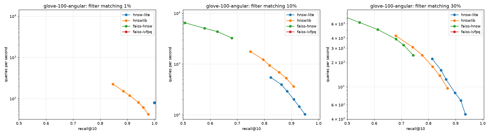
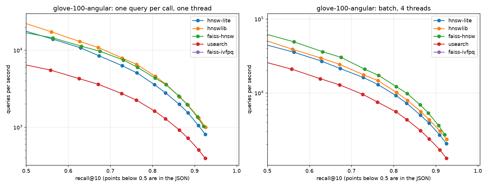
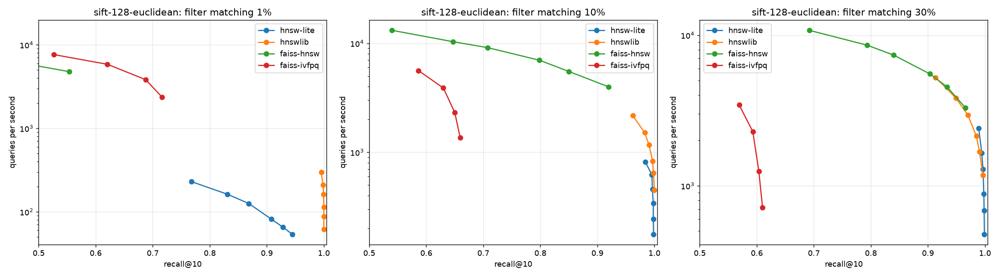
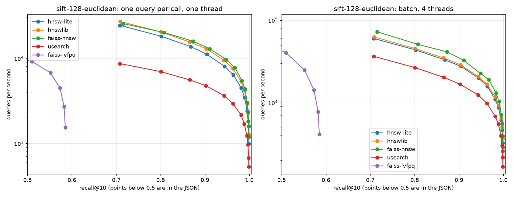

# Real-dataset comparisons

hnsw-lite against hnswlib, FAISS (HNSW and IVF-PQ) and USearch on standard ann-benchmarks datasets, whose files include the exact neighbors of every query. Published by `.github/workflows/real-benchmarks.yml` from `bench/python/compare.py` ([methodology](https://github.com/praknig/hnsw_lite/blob/master/docs/benchmarks.md)). Graph libraries share M and ef_construction; each library's search beam is swept, so curves compare at equal recall, never at equal settings. Every run is kept in `history/`.

[Nightly benchmark](../README.md)

## glove-100-angular

Published 2026-10-26 12:52 UTC from commit [`1fc4117`](https://github.com/praknig/hnsw_lite/commit/1fc411758e6ad454082aa1889dc586f73746f245) ([run](https://github.com/praknig/hnsw_lite/actions/runs/40313085089)).

1,183,514 vectors of 100 dimensions (cosine), 10,000 queries; M 16, ef_construction 200; AMD EPYC 7763 64-Core Processor, 4 threads; median of 3 runs; 2026-10-26.

Queries per second at a recall@10 of at least 0.90 / 0.95 / 0.99 (one query per call, one thread), and build cost:

| Library | q/s @ 0.90 | q/s @ 0.95 | q/s @ 0.99 | batch q/s @ 0.95 | build (s) | memory (MB) | index file (MB) |
|---|---|---|---|---|---|---|---|
| hnsw-lite | 1,047 | — | — | — | 262.4 | 1267 | 1027 |
| hnswlib | 1,319 | — | — | — | 223.9 | 735 | 619 |
| faiss-hnsw | 1,354 | — | — | — | 194.6 | 654 | 614 |
| usearch | 504 | — | — | — | 367.5 | 774 | 619 |
| faiss-ivfpq | — | — | — | — | 38.4 | 85 | 15 |

Filtered search: queries per second at a recall@10 of at least 0.95 (one thread). The filter keeps vectors whose bucket (id % 100) is below the percentage, so matches are spread evenly; hnsw-lite filters on metadata stored in the index, hnswlib with a Python callback, FAISS with an ID selector:

| Library | 1% matching | 10% matching | 30% matching |
|---|---|---|---|
| hnsw-lite | 80.11 | — | — |
| hnswlib | 60.90 | — | — |
| faiss-hnsw | — | — | — |
| faiss-ivfpq | — | — | — |

— : the library did not reach that recall in the sweep, or does not support it.

Versions: hnsw-lite 0.1.0, hnswlib 0.8.0, faiss 1.15.1, usearch 2.26.6, numpy 2.5.4; Python 3.12.15.

## sift-128-euclidean

Published 2026-10-26 12:52 UTC from commit [`1fc4117`](https://github.com/praknig/hnsw_lite/commit/1fc411758e6ad454082aa1889dc586f73746f245) ([run](https://github.com/praknig/hnsw_lite/actions/runs/40313085089)).

1,000,000 vectors of 128 dimensions (l2), 10,000 queries; M 16, ef_construction 200; AMD EPYC 7763 64-Core Processor, 4 threads; median of 3 runs; 2026-10-26.

Queries per second at a recall@10 of at least 0.90 / 0.95 / 0.99 (one query per call, one thread), and build cost:

| Library | q/s @ 0.90 | q/s @ 0.95 | q/s @ 0.99 | batch q/s @ 0.95 | build (s) | memory (MB) | index file (MB) |
|---|---|---|---|---|---|---|---|
| hnsw-lite | 11,164 | 6,398 | 2,396 | 15,854 | 156.1 | 701 | 586 |
| hnswlib | 12,948 | 7,580 | 2,933 | 16,760 | 147.8 | 732 | 630 |
| faiss-hnsw | 12,930 | 7,772 | 4,345 | 19,013 | 150.4 | 656 | 626 |
| usearch | 4,753 | 2,926 | 1,221 | 9,812 | 220.8 | 733 | 630 |
| faiss-ivfpq | — | — | — | — | 36.2 | 154 | 25 |

Filtered search: queries per second at a recall@10 of at least 0.95 (one thread). The filter keeps vectors whose bucket (id % 100) is below the percentage, so matches are spread evenly; hnsw-lite filters on metadata stored in the index, hnswlib with a Python callback, FAISS with an ID selector:

| Library | 1% matching | 10% matching | 30% matching |
|---|---|---|---|
| hnsw-lite | — | 816 | 2,409 |
| hnswlib | 297 | 2,172 | 2,948 |
| faiss-hnsw | — | — | 3,294 |
| faiss-ivfpq | — | — | — |

— : the library did not reach that recall in the sweep, or does not support it.

Versions: hnsw-lite 0.1.0, hnswlib 0.8.0, faiss 1.15.1, usearch 2.26.6, numpy 2.5.4; Python 3.12.15.

