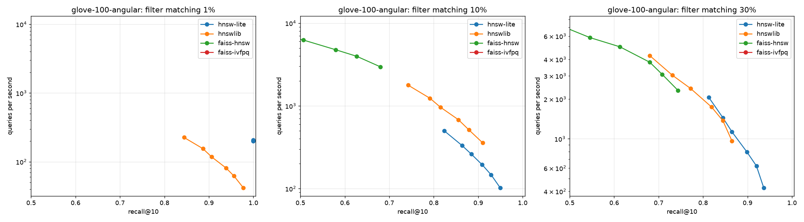
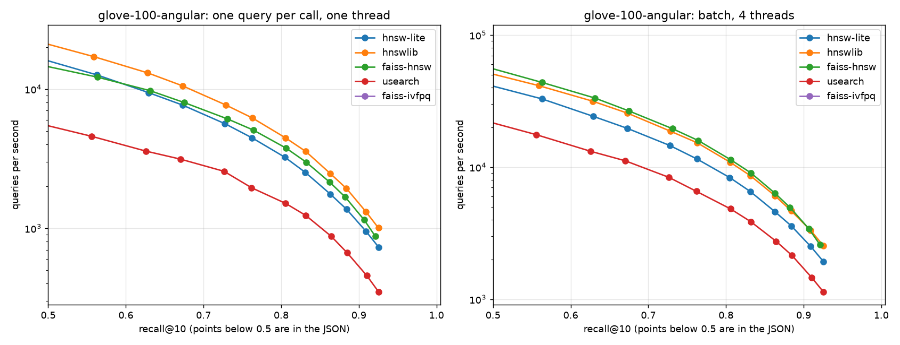
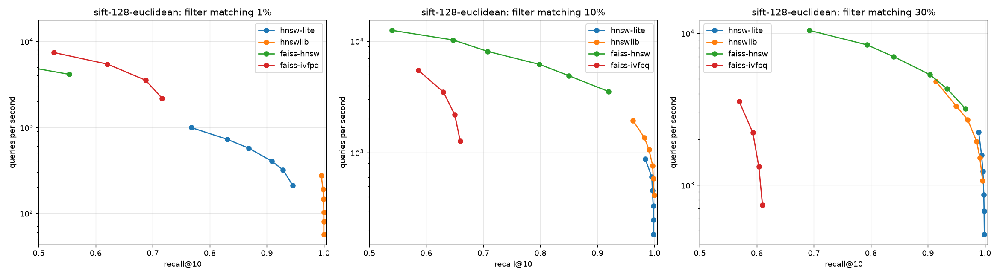
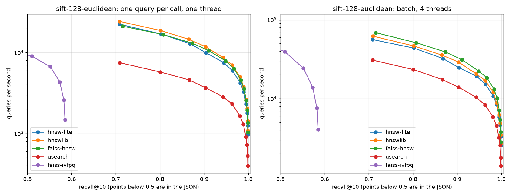

# Real-dataset comparisons

hnsw-lite against hnswlib, FAISS (HNSW and IVF-PQ) and USearch on standard ann-benchmarks datasets, whose files include the exact neighbors of every query. Published by `.github/workflows/real-benchmarks.yml` from `bench/python/compare.py` ([methodology](https://github.com/praknig/hnsw_lite/blob/master/docs/benchmarks.md)). Graph libraries share M and ef_construction; each library's search beam is swept, so curves compare at equal recall, never at equal settings. Every run is kept in `history/`.

[Nightly benchmark](../README.md)

## glove-100-angular

Published 2026-11-01 12:14 UTC from commit [`5fdfda5`](https://github.com/praknig/hnsw_lite/commit/5fdfda5fd8f0e216185417306d7e18a9a5b70e83) ([run](https://github.com/praknig/hnsw_lite/actions/runs/41299672137)).

1,183,514 vectors of 100 dimensions (cosine), 10,000 queries; M 16, ef_construction 200; AMD EPYC 7763 64-Core Processor, 4 threads; median of 3 runs; 2026-11-01.

Queries per second at a recall@10 of at least 0.90 / 0.95 / 0.99 (one query per call, one thread), and build cost:

| Library | q/s @ 0.90 | q/s @ 0.95 | q/s @ 0.99 | batch q/s @ 0.95 | build (s) | memory (MB) | index file (MB) |
|---|---|---|---|---|---|---|---|
| hnsw-lite | 951 | — | — | — | 281.6 | 1259 | 1027 |
| hnswlib | 1,313 | — | — | — | 219.4 | 735 | 619 |
| faiss-hnsw | 1,150 | — | — | — | 205.9 | 659 | 614 |
| usearch | 456 | — | — | — | 407.9 | 771 | 619 |
| faiss-ivfpq | — | — | — | — | 39.0 | 83 | 15 |

Filtered search: queries per second at a recall@10 of at least 0.95 (one thread). The filter keeps vectors whose bucket (id % 100) is below the percentage, so matches are spread evenly; hnsw-lite filters on metadata stored in the index, hnswlib with a Python callback, FAISS with an ID selector:

| Library | 1% matching | 10% matching | 30% matching |
|---|---|---|---|
| hnsw-lite | 206 | — | — |
| hnswlib | 61.86 | — | — |
| faiss-hnsw | — | — | — |
| faiss-ivfpq | — | — | — |

— : the library did not reach that recall in the sweep, or does not support it.

Versions: hnsw-lite 0.1.0, hnswlib 0.8.0, faiss 1.15.1, usearch 2.26.6, numpy 2.5.4; Python 3.12.15.

## sift-128-euclidean

Published 2026-11-01 12:14 UTC from commit [`5fdfda5`](https://github.com/praknig/hnsw_lite/commit/5fdfda5fd8f0e216185417306d7e18a9a5b70e83) ([run](https://github.com/praknig/hnsw_lite/actions/runs/41299672137)).

1,000,000 vectors of 128 dimensions (l2), 10,000 queries; M 16, ef_construction 200; AMD EPYC 7763 64-Core Processor, 4 threads; median of 3 runs; 2026-11-01.

Queries per second at a recall@10 of at least 0.90 / 0.95 / 0.99 (one query per call, one thread), and build cost:

| Library | q/s @ 0.90 | q/s @ 0.95 | q/s @ 0.99 | batch q/s @ 0.95 | build (s) | memory (MB) | index file (MB) |
|---|---|---|---|---|---|---|---|
| hnsw-lite | 9,955 | 5,970 | 2,303 | 15,291 | 159.0 | 701 | 586 |
| hnswlib | 11,806 | 7,013 | 2,604 | 17,033 | 147.8 | 732 | 630 |
| faiss-hnsw | 10,508 | 6,335 | 3,539 | 18,383 | 156.7 | 665 | 626 |
| usearch | 3,669 | 2,330 | 905 | 8,350 | 248.3 | 732 | 630 |
| faiss-ivfpq | — | — | — | — | 37.4 | 156 | 25 |

Filtered search: queries per second at a recall@10 of at least 0.95 (one thread). The filter keeps vectors whose bucket (id % 100) is below the percentage, so matches are spread evenly; hnsw-lite filters on metadata stored in the index, hnswlib with a Python callback, FAISS with an ID selector:

| Library | 1% matching | 10% matching | 30% matching |
|---|---|---|---|
| hnsw-lite | — | 874 | 2,229 |
| hnswlib | 272 | 1,935 | 2,696 |
| faiss-hnsw | — | — | 3,176 |
| faiss-ivfpq | — | — | — |

— : the library did not reach that recall in the sweep, or does not support it.

Versions: hnsw-lite 0.1.0, hnswlib 0.8.0, faiss 1.15.1, usearch 2.26.6, numpy 2.5.4; Python 3.12.15.

