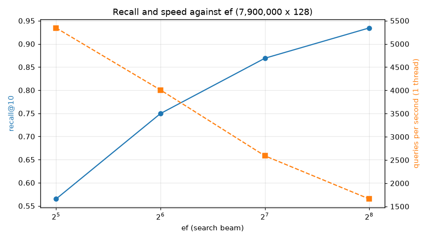
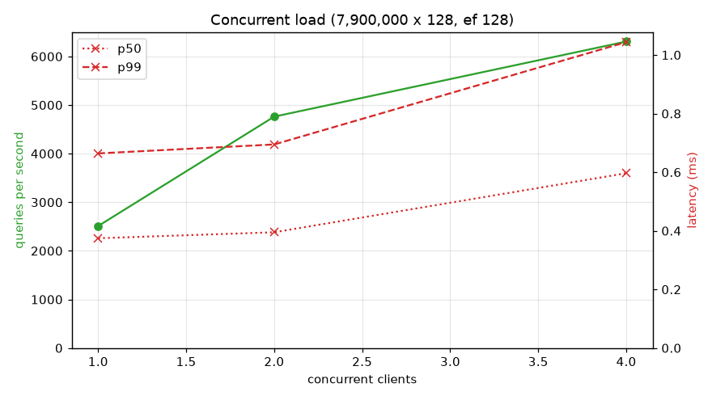
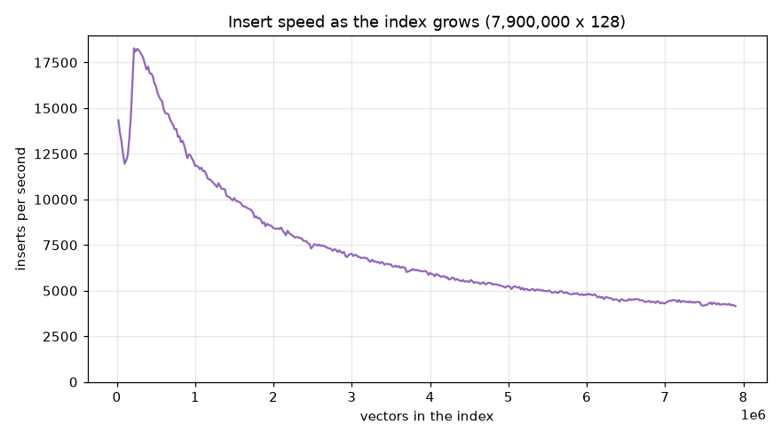
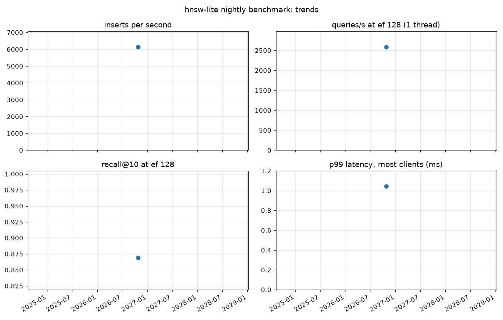

# hnsw-lite benchmarks

Published by the nightly workflow (`.github/workflows/benchmark.yml`) from `bench/python/stress.py`. Every run is kept in `runs/`; this page shows the newest and the trends.

## Latest: 2026-10-25 04:40 UTC, commit [`4c6176d`](https://github.com/praknig/hnsw_lite/commit/4c6176dafe09e86b8647cc4ce5f9acd1c38a92f8)

**7,900,000 vectors of 128 dimensions**, M 16, ef_construction 200; 4 cores; Python 3.12.15. **16 of 17 checks passed** ([run](https://github.com/praknig/hnsw_lite/actions/runs/40160978127)).

## Trends

Runs on different machines or of different sizes are not directly comparable (sizes are marked on the chart when they vary).

| Date (UTC) | Commit | Vectors | Inserts/s | Recall@10 (ef 128) | Queries/s (ef 128) | p99 ms | Checks |
|---|---|---|---|---|---|---|---|
| 2026-10-25 04:40 | `4c6176d` | 7,900,000 | 6,148 | 0.869 | 2,590 | 1.04 | 16/17 **FAIL** |

## Failed checks in the latest run

- recall@10 at ef 128 is at least 0.9: 0.869
